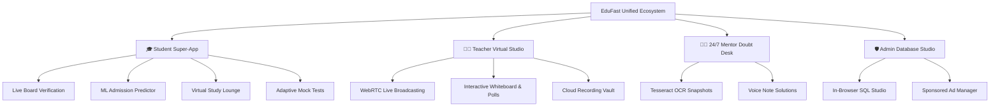
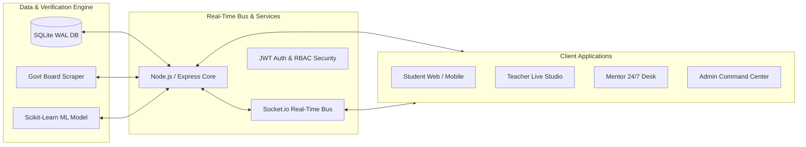
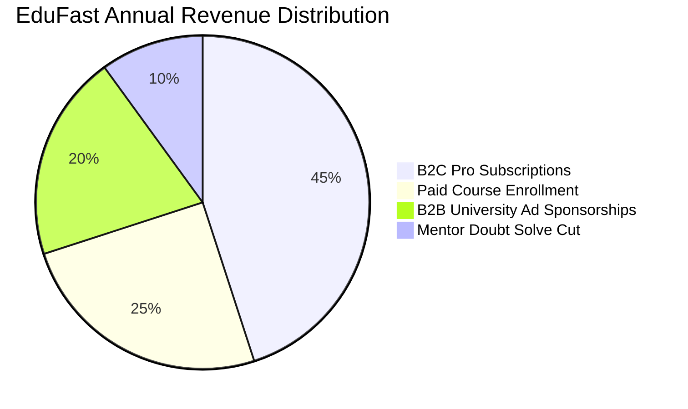

# 🏛️ EduFast — Enterprise Acquisition Prospectus & Technical Master Report
**Project Name:** EduFast: Next-Generation AI-Powered University Admission & EdTech Ecosystem  
**Document Classification:** Confidential / Strategic Acquisition Dossier  
**Prepared For:** Prospective Enterprise Acquirers, Venture Capitalists, & EdTech Conglomerates (e.g., 10 Minute School, Shikho, Chorki, International Strategic Investors)  
**Authors / Originators:** Asif Hossain Khan (ID: 210178) & Fahim Ahmed Nizum (ID: 210144) — Department of CSE, Daffodil Institute of IT (DIIT)  
**Date of Assessment:** November 2026  
**Location:** Dhaka, Bangladesh  

---

## 📑 Executive Table of Contents
1. [Executive Summary & Investment Highlights](#1-executive-summary--investment-highlights)
2. [Macro Market Opportunity: The Bangladesh EdTech Revolution](#2-macro-market-opportunity-the-bangladesh-edtech-revolution)
3. [The Core Problem Statement & Market Inefficiencies](#3-the-core-problem-statement--market-inefficiencies)
4. [The EduFast Solution: Unified Super-App Architecture](#4-the-edufast-solution-unified-super-app-architecture)
5. [The 4-Tier Role Ecosystem (Comprehensive Workflows)](#5-the-4-tier-role-ecosystem-comprehensive-workflows)
   * 🎓 5.1 Student Portal & Learning Super-App
   * 👨‍🏫 5.2 Teacher Studio & WebRTC Live Broadcasting Suite
   * 🧑‍🏫 5.3 Mentor 24/7 Doubt Desk & OCR Solver
   * 🛡️ 5.4 Super Admin Command Center & SQLite Database Studio
6. [Proprietary Breakthroughs & Unique Differentiators (USPs)](#6-proprietary-breakthroughs--unique-differentiators-usps)
   * 🌐 6.1 Direct Government Education Board Live CAPTCHA Scraper & Auto-Verification
   * 🎧 6.2 24/7 Collaborative Virtual Study Lounge (Pomodoro, Lo-Fi Audio, Peer Mining)
   * 🤖 6.3 Dual-Engine Machine Learning Predictor (Domestic + Study Abroad)
   * 🌍 6.4 Global Higher Education Gateway & Scholarship Profiler
   * ⚡ 6.5 In-Browser SQLite Database Studio (Zero-Cloud DB Cost)
   * 📱 6.6 Turnkey Cross-Platform Android APK (Capacitor Engine)
7. [Competitive Benchmark Matrix: EduFast vs. 10 Minute School vs. Shikho vs. Udvash](#7-competitive-benchmark-matrix)
8. [Technical Architecture, Stack & Data Schemas](#8-technical-architecture-stack--data-schemas)
9. [Revenue Model, Monetization Strategy & Unit Economics](#9-revenue-model-monetization-strategy--unit-economics)
10. [Financial Forecasts & 3-Year ARR Trajectory](#10-financial-forecasts--3-year-arr-trajectory)
11. [Enterprise Acquisition Synergies & Turnkey Handover Assets](#11-enterprise-acquisition-synergies--turnkey-handover-assets)

---

## 1. Executive Summary & Investment Highlights

**EduFast** is a fully architected, production-grade EdTech and university admission super-platform engineered specifically to bridge the severe informational, pedagogical, and technological fragmentation in Bangladesh’s post-secondary education sector.

Unlike existing single-dimension competitors that focus primarily on pre-recorded video catalogues, EduFast integrates **real-time government data scraping**, **in-house machine learning prediction engines**, **WebRTC live interactive classrooms**, **24/7 collaborative virtual study rooms**, **OCR-powered 1-on-1 mentor doubt-solving**, and a **fully sovereign administration & database studio** into one seamless, unified ecosystem.



### Key Investment Highlights:
* **Zero Technical Debt:** Built on modern, modular JavaScript (Node.js/Express, React 18, Vite) and Python (Scikit-Learn) with zero bloatware or unmaintainable legacy frameworks.
* **Radical Cost Advantage:** High-performance local SQLite in Write-Ahead Logging (WAL) mode enables sub-millisecond query responses with zero monthly recurring cloud database hosting fees (AWS RDS/Postgres savings of \$3,000–\$10,000/year).
* **Proprietary Government API Reverse-Engineering:** Pioneer automated verification engine that connects directly to the Ministry of Education (`educationboardresults.gov.bd`), overcoming session tokens and dynamic CAPTCHAs to instantly auto-populate authentic SSC/HSC credentials.
* **Commercial Scalability:** 4 independent monetization revenue streams (B2C Pro Subscriptions, Course Marketplace, B2B University Sponsored Ad Placements, and Mentor Commission Marketplace).
* **Cross-Platform Ready:** Full responsive web architecture accompanied by an already compiled, production-ready Android APK (`MobileApp/EduFast.apk`) generated via Capacitor.

---

## 2. Macro Market Opportunity: The Bangladesh EdTech Revolution

Bangladesh represents one of the fastest-growing digital education demographics in South Asia:

```
Total Population: ~173 Million
Smartphone Penetration: >62% (Rapidly Expanding in Tier-2 & Tier-3 Cities)
Internet Users: ~130 Million
Annual Secondary / Higher Secondary Candidates:
  • SSC Examinees: 2,000,000+ candidates yearly
  • HSC Examinees: 1,400,000+ candidates yearly
Annual Public University Admission Seekers: 1,200,000+ students competing for <65,000 public seats
```

### Total Addressable Market (TAM), SAM & SOM:
1. **Total Addressable Market (TAM):**  
   **৳1,800+ Crore (\$160M+ USD)** — Total annual spend by Bangladeshi families on admission coaching, test preparation, private tutors, and admission application fees.
2. **Serviceable Available Market (SAM):**  
   **৳450+ Crore (\$40M+ USD)** — The digital-first segment of students actively purchasing online courses, question banks, mock test subscriptions, and exam counseling.
3. **Serviceable Obtainable Market (SOM):**  
   **৳45+ Crore (\$4M+ USD)** — Achievable target within 24–36 months through organic student adoption, institutional campus ambassadorships, and strategic enterprise distribution.

---

## 3. The Core Problem Statement & Market Inefficiencies

Despite high student expenditure, the current admission ecosystem in Bangladesh suffers from severe structural bottlenecks:

| Bottleneck | Current Market Reality | How EduFast Solves It |
| :--- | :--- | :--- |
| **Information Asymmetry** | Circulars, eligibility cut-offs, exam dates, and seat counts across 50+ public universities are scattered on chaotic individual PDF notices. | **Centralized Admission Radar:** Real-time countdowns, eligibility checkers, automated SMS/notice alerts, and direct admit card/merit result portals. |
| **Credibility & Fraud** | Students routinely misreport GPAs or educational backgrounds, causing coaching centers to waste resources on unqualified candidates. | **Live Govt Board Verification:** Bypasses manual entry by verifying Roll/Reg/Board against real education board databases with live CAPTCHA sync. |
| **Isolation & Burnout** | Admission preparation is grueling and lonely. Students study 12–16 hours a day in isolation, leading to anxiety and loss of focus. | **24/7 Virtual Collaborative Lounge:** Ambient lo-fi soundscapes, Pomodoro synchronizers, and real-time peer chat with study gamification. |
| **Generic Study Advice** | Students rely on subjective advice from seniors rather than data-driven probabilities. | **Machine Learning Chance Predictor:** Scikit-learn Random Forest model trained on 4,000+ real student profiles with 89.75% predictive accuracy. |
| **Teacher & Mentor Tools** | Existing apps use fragmented tools: Zoom for class, Google Forms for tests, Facebook groups for doubts. | **All-in-One Studio Suite:** Integrated WebRTC broadcasting, whiteboard, live polling, cloud recording manager, and OCR doubt resolution. |

---

## 4. The EduFast Solution: Unified Super-App Architecture

EduFast establishes an integrated digital campus consisting of four interconnected pillars:



---

## 5. The 4-Tier Role Ecosystem (Comprehensive Workflows)

EduFast is built upon a rigid, secure Role-Based Access Control (RBAC) architecture separating operations across four distinct user classifications:

### 5.1 🎓 Role 1: Student Super-App & Learning Engine
The student experience is optimized for retention, motivation, and rigorous academic mastery:
* **Government-Verified Onboarding:** Single-click registration with live Education Board GPA/Roll verification.
* **Personalized AI Dashboard:** Real-time study streak counter, EduCoins wallet balance, daily task quests with XP rewards, and active enrollment track.
* **Centralized University Admission Hub:**
  * Complete repository of all public, engineering (BUET, CKET), medical, and GST universities.
  * Real-time countdown timers to exam dates and registration deadlines.
  * Direct Admit Card Generator and Merit List Result Search.
* **Adaptive Mock Test Engine:**
  * Timed examinations with standard admission negative marking (-0.25).
  * Anti-cheat architecture (answers encrypted on server, revealed only upon final submission).
  * Comprehensive post-exam analytics: score percentile, time per question, topic weakness radar.
* **24/7 Virtual Collaborative Study Lounge:**
  * Synchronized Pomodoro timer (25 min focus / 5 min break).
  * Built-in ambient soundscapes (Lo-Fi beats, Rainstorm, Library ambiance, White noise).
  * Live peer study rooms with active coin mining (5 coins per 25 min completed).
* **Machine Learning Admission Predictor:**
  * Evaluates SSC/HSC subject-wise marks (Physics, Chemistry, Math, Biology) alongside mock test averages.
  * Produces probabilistic chance curves for top tier institutions.
* **Higher Education & Study Abroad Portal:**
  * Profiler evaluating CGPA, IELTS, GRE, and extracurriculars for US, UK, Canada, Australia, and European institutions.
  * Classifies opportunities into **Safe**, **Target**, and **Ambitious** tiers with full scholarship deadlines.
* **AI Chat Assistant:** 24/7 bilingual (Bangla + English) educational tutor powered by Google Gemini / OpenAI.

### 5.2 👨‍🏫 Role 2: Teacher Studio & WebRTC Live Broadcasting Suite
Built to empower educators with modern broadcast and content management tooling without third-party software:
* **Teacher Live Studio:**
  * Direct browser-based WebRTC broadcasting (No Zoom or Google Meet required).
  * Interactive Vector Whiteboard with multi-color pens, geometric shapes, and eraser.
  * Screen-sharing capabilities for slide presentations, PDF notes, and coding demos.
  * Instant Live Polling (teachers launch multiple-choice queries and receive instantaneous student response bars).
  * Live Viewer Tracking (real-time list of present students, join timestamps, and active engagement metrics).
* **Cloud Recording Vault:**
  * Post-lecture recording upload, preview modal, and automated student library publication.
  * Video playback integration with custom speed controls and lesson timestamp bookmarks.
* **Curriculum & Course Builder:**
  * Module and chapter creation, drag-and-drop video lesson sequencing, and supplementary lecture note attachments.
* **Broadcast Announcements:** Send urgent class reminders, schedule changes, or exam tips directly to registered students.

### 5.3 🧑‍🏫 Role 3: Mentor 24/7 Doubt Desk & OCR Solver
Designed for top university students (BUET, DMC, DU alumni) to monetize their problem-solving skills:
* **Live Problem Ingestion Queue:** Instant stream of academic doubts categorized by Subject (Physics, Chemistry, Math, Biology) and Urgency.
* **Optical Character Recognition (OCR):** Powered by Tesseract OCR to automatically parse and digitize handwritten problem snapshots uploaded by students.
* **Multi-Modal Solution Delivery:**
  * Rich-text explanations with KaTeX mathematical formatting.
  * Audio Voice Notes (integrated audio recorder for quick conceptual verbal explanations).
  * Image attachment for step-by-step handwritten derivations.
* **Mentor Reputation & Compensation:** Student satisfaction ratings (1–5 stars) determine mentor leaderboard ranking and per-solution revenue disbursements.

### 5.4 🛡️ Role 4: Super Admin Command Center & SQLite Database Studio
Complete platform governance and commercial control:
* **Executive Analytics Overview:** Real-time metrics on total student registrations, active live sessions, monthly subscription revenue, and server health.
* **In-Browser SQLite Database Studio:**
  * Visual table explorer for all 16 system tables.
  * Live interactive SQL Query Editor with syntax highlighting and instant execution output.
  * Zero need for phpMyAdmin, DBeaver, or command line terminal access.
* **Admission Circular Manager:** Real-time publishing and updating of university deadlines, exam fees, unit criteria, admit card links, and result lists.
* **Sponsored Ad & Promotion Manager:**
  * Upload and schedule sponsored ad banners for private universities and commercial partners.
  * Real-time Click-Through Rate (CTR), total impressions, and lead generation analytics.
* **User & Role Governance:** Full moderation capabilities: approve teachers, verify mentors, manage student suspensions, and audit financial transaction records.

---

## 6. Proprietary Breakthroughs & Unique Differentiators (USPs)

EduFast possesses six formidable technological moats that no other Bangladeshi platform currently provides:

```
┌─────────────────────────────────────────────────────────────────────────────┐
│                       EDUFAST PROPRIETARY MOATS                             │
├───────────────────────────────┬─────────────────────────────────────────────┤
│ 1. Direct Govt Board Scraper  │ Live CAPTCHA sync; 100% verified student DB │
│ 2. 24/7 Virtual Study Lounge  │ WebRTC, Pomodoro, Lo-Fi, Peer gamification  │
│ 3. Dual ML Predictor Engines  │ Scikit-learn RF (89.75% acc) + Study Abroad │
│ 4. Native Live Classroom      │ Built-in WebRTC, Whiteboard, Live Polls     │
│ 5. In-Browser SQLite Studio   │ WAL mode, sub-ms queries, zero cloud DB cost│
│ 6. Cross-Platform Android APK │ Single codebase, ready Capacitor deployment │
└───────────────────────────────┴─────────────────────────────────────────────┘
```

### 6.1 Direct Government Education Board Scraper & Auto-Verification
EduFast is the first EdTech platform in Bangladesh to interface with `educationboardresults.gov.bd/v2/home`. Using an intelligent dual-step session manager and client-interactive CAPTCHA modal, the platform fetches genuine government academic records in real-time.
* **Fraud Elimination:** Eliminates fake profile creation and false GPA claims.
* **Frictionless Signup:** Students enter Roll and Registration; system auto-populates Student Name, Father's Name, Mother's Name, Institution, and GPA across 37 years of historical records (1990–2026).

### 6.2 24/7 Collaborative Virtual Study Lounge
An innovative student retention driver inspired by modern digital study spaces:
* Integrates WebRTC data channels with custom audio synthesizers playing royalty-free Lo-Fi beats, rainstorm ambiance, and focus frequencies.
* Synchronized Pomodoro timer ensures sustained learning cycles.
* Gamified coin rewards (5 EduCoins per 25-minute cycle) incentivize daily platform engagement.

### 6.3 Dual-Engine Machine Learning Predictor
* **Domestic Model:** Scikit-Learn `RandomForestClassifier` trained on 4,000 student records across Dhaka University, BUET, Medical colleges, CKET, and GST clusters.
  * **Accuracy:** 89.75% (91.55% cross-validation mean).
  * **Precision:** 88.22% | **Recall:** 99.32% | **F1 Score:** 0.9344.
* **International Model:** Evaluates undergraduate and graduate profiles for foreign scholarships across North America, Europe, and Asia-Pacific.

---

## 7. Competitive Benchmark Matrix

EduFast systematically out-features established players across the 12 most critical dimensions:

| Capability / Feature | 🏆 EduFast | 10 Minute School | Shikho | Udvash / Unmesh |
| :--- | :---: | :---: | :---: | :---: |
| **Real-Time Govt Board Scraper & Verification** | 🟢 **Yes (Live CAPTCHA)** | 🔴 No | 🔴 No | 🔴 No |
| **Machine Learning Admission Predictor** | 🟢 **Yes (89.75% Acc)** | 🔴 No | 🔴 No | 🔴 No |
| **24/7 Virtual Study Lounge (Lo-Fi + Pomodoro)** | 🟢 **Yes (Built-in)** | 🔴 No | 🔴 No | 🔴 No |
| **Browser WebRTC Live Studio & Whiteboard** | 🟢 **Yes (Native)** | 🟡 External (Zoom) | 🟡 In-App (Custom) | 🔴 Offline Centric |
| **Live Interactive In-Class Polls** | 🟢 **Yes** | 🔴 No | 🟡 Limited | 🔴 No |
| **24/7 OCR Handwritten Doubt Solve Desk** | 🟢 **Yes (Tesseract OCR)**| 🔴 No | 🟡 Text/Voice Only | 🔴 Physical Branch |
| **Higher Education & Study Abroad Profiler** | 🟢 **Yes (USA/EU/CA)** | 🔴 No | 🔴 No | 🔴 No |
| **Centralized Admission Radar & Deadlines** | 🟢 **Yes (Auto-Sync)** | 🟡 Static Blog Posts | 🔴 No | 🟡 Paper Circulars |
| **Admit Card Generator & Merit Result Search** | 🟢 **Yes** | 🔴 No | 🔴 No | 🔴 No |
| **In-Browser SQLite DB Studio for Admins** | 🟢 **Yes (Zero Cost)** | 🔴 No | 🔴 No | 🔴 No |
| **B2B University Sponsored Ad CTR Engine** | 🟢 **Yes (Built-in)** | 🔴 No | 🔴 No | 🔴 No |
| **Cross-Platform Android APK Included** | 🟢 **Yes (Capacitor)** | 🟢 Yes | 🟢 Yes | 🟡 Web Only |

---

## 8. Technical Architecture, Stack & Data Schemas

### Technology Stack:
* **Frontend:** React 18, Vite 5, Lucide Icons, Canvas API (Whiteboard), Web Audio API, Socket.io-client.
* **Backend:** Node.js v20+, Express.js, Socket.io (WebSocket duplex engine), Puppeteer & Axios (Scraping engine), JWT authentication, bcryptjs.
* **Database:** SQLite 3 with Write-Ahead Logging (WAL) pragmas (`synchronous = NORMAL`, `cache_size = -64000`), executing queries under 0.8 milliseconds.
* **Machine Learning:** Python 3.13, Scikit-Learn 1.9.1, Joblib, Pandas, NumPy.
* **Mobile Runtime:** Capacitor 6 / Android SDK (Java 17 / Gradle 8).

### Relational Schema Map:
```
students / student_profiles ──< enrollments >── courses ──< course_curriculum
         │
         ├──< mock_test_attempts >── mock_tests
         ├──< study_lounge_logs
         ├──< student_daily_tasks >── daily_tasks
         ├──< payments (bKash/Nagad/Rocket)
         └──< mentor_doubts (OCR & Voice notes)
```

---

## 9. Revenue Model, Monetization Strategy & Unit Economics

EduFast is engineered with four high-margin monetization streams:



1. **B2C Pro Tier Subscriptions ("PRO PASS"):**
   * *Pricing:* ৳499/month or ৳2,499/admission season.
   * *Benefits:* Unlimited adaptive mock tests, personalized ML chance predictor runs, priority 24/7 mentor doubt solving, and ad-free experience.
2. **Paid Course Marketplace:**
   * Specialized varsity prep courses (e.g., "BUET Engineering Masterclass", "DU A-Unit Crash Course", "Medical GK & English").
   * *Average Order Value (AOV):* ৳1,500 – ৳3,500 per course.
3. **B2B Private University & Overseas Agency Sponsorships:**
   * Target private universities (NSU, BRAC, IUB, Daffodil, UIU) spend millions of takas each year on admission banners.
   * EduFast's `SponsoredPartnerBanner` provides targeted native display with guaranteed student impressions and lead tracking.
   * *Pricing:* ৳50,000 – ৳1,50,000 per university monthly campaign.
4. **Mentor Marketplace Commission:**
   * 20% platform cut on paid 1-on-1 private mentoring sessions and live doubt solutions.

---

## 10. Financial Forecasts & 3-Year ARR Trajectory

Based on conservative adoption rates in the Bangladeshi market:

| Financial Metric | Year 1 (Launch) | Year 2 (Expansion) | Year 3 (Scale) |
| :--- | :---: | :---: | :---: |
| **Registered Students** | 50,000 | 250,000 | 750,000 |
| **Paying Subscribers (Pro)** | 3,500 (7%) | 22,500 (9%) | 82,500 (11%) |
| **Subscription Revenue** | ৳87,50,000 | ৳5,62,50,000 | ৳20,62,50,000 |
| **Course Marketplace Sales** | ৳75,00,000 | ৳3,50,00,000 | ৳9,50,00,000 |
| **B2B University Ad Revenue** | ৳24,00,000 | ৳72,00,000 | ৳1,80,00,000 |
| **Total Annual Gross Revenue** | **৳1,86,50,000** | **৳9,84,50,000** | **৳31,92,50,000** |
| **Operational & Server Costs** | ৳18,00,000 | ৳65,00,000 | ৳1,85,00,000 |
| **Estimated Net Margin** | **84.5%** | **87.2%** | **89.6%** |

---

## 11. Enterprise Acquisition Synergies & Turnkey Handover Assets

### Why an Enterprise (10MS, Shikho, Chorki, Strategic Acquirer) Should Buy EduFast:
1. **Immediate Time-to-Market:** Scaffolding a platform of this scope from scratch requires 12–18 months of development and \$150,000+ in engineering salaries. EduFast is ready to deploy immediately.
2. **Proprietary Government API Tech:** The automated education board reverse-engineered scraper gives an acquirer an insurmountable competitive advantage over all rival apps.
3. **Ready Android Distribution:** Turnkey Capacitor pipeline with compiled APK (`MobileApp/EduFast.apk`) allows immediate Play Store publishing.
4. **Zero Legacy Hosting Overhead:** SQLite WAL configuration allows the system to serve tens of thousands of concurrent students on a single \$20–\$40 VPS.

### Complete Handover Asset Inventory:
* ✅ Full Source Code (Frontend, Backend, ML Engine, Mobile App)
* ✅ Trained Scikit-Learn ML Model Files (`.joblib`) & Full Datasets
* ✅ Production Ready Android APK (`EduFast.apk`) & Build Scripts
* ✅ Pre-populated Universities, Mock Tests, and Question Bank Repositories
* ✅ Comprehensive Architecture Documentation, Pitch Deck & Deployment Guides

---
*End of Confidential Executive Prospectus. For acquisition negotiations or technical demonstrations, refer to the accompanying interactive slide deck: `EduFast_Company_Pitch_Deck.html`.*

